# NoShow Shield · Smart reminders, one-tap reschedule, waitlist refill

> 🎥 **Loom demo (60–90s):** _LOOM_LINK_HERE_

Missed appointments cost clinics money and leave other patients waiting. NoShow Shield sends patients a reminder **24 hours and 2 hours** before each appointment. Each reminder carries a **one-tap link** to confirm, reschedule or cancel. When a slot opens up, it's **offered to the waitlist automatically**, and the first patient to tap gets it.

Built with **n8n** (self-hosted), **Twilio** (WhatsApp / SMS) and **Google Calendar**, with Google Sheets as the message and activity log.

---

## Problem

No-shows run at roughly 10–30% in many outpatient clinics. Most happen because patients forget or can't easily change their booking: calling the front desk to reschedule is friction, so people just don't turn up. When someone does cancel, the slot usually stays empty, because nobody has time to call down a waitlist.

## Who it's for

- Clinics, dental practices, physiotherapists and salons that book on a Google Calendar
- Agencies that automate patient communication for healthcare clients

## Features

- **SMS/WhatsApp reminders:** a 24h reminder and a 2h reminder, checked every 15 minutes.
  - A reminder is never sent twice. Every send is logged, so a missed run catches up and an extra run does nothing.
  - Only patients with `Consent: yes` and a valid number are messaged.
- **One-tap reschedule:** each reminder has a signed, expiring link. It opens a simple mobile page with **Confirm**, **Reschedule** and **Cancel** buttons.
  - *Confirm* marks the event green in the calendar.
  - *Reschedule* lists the next free slots within clinic hours (at least 1 hour's notice), and moves the event in one tap.
  - *Cancel* asks for a second tap (so link previews can't cancel by accident), then frees the slot.
- **Waitlist refill:** a freed slot is offered to the next matching waitlisted patients (2 at a time), matched on morning/afternoon preference, service and consent, oldest first.
  - The first to tap **Book it** gets the appointment created in the calendar. Anyone after that sees "someone else took this slot", because the calendar is the source of truth.
  - Offers expire after 60 minutes or when the slot starts. Nobody is offered the same slot twice.
- **Full audit trail:** every message (to Outbox) and every patient action (to Activity) is logged in Google Sheets. Phone numbers are masked.

## Stack

| Layer | Tool |
|---|---|
| Orchestration | n8n Community Edition, self-hosted, exposed with a free Cloudflare quick tunnel |
| Appointments | Google Calendar (service account; details in each event's description) |
| Messaging | Twilio: a WhatsApp approved template (free trial) or SMS |
| Logs + waitlist | Google Sheets (`Outbox`, `Waitlist`, `Activity`) |
| Logic + tests | Plain JavaScript (`src/noshow.js`), Node's built-in test runner |

## Architecture

```mermaid
flowchart TD
    subgraph R[Workflow 1 · Reminders]
      S[Every 15 min / run-now link] --> L1[Google Calendar: next 26h]
      L1 --> O1[Sheets: Outbox sent log]
      O1 --> P[Code: dueReminders<br/>24h / 2h windows, dedupe, consent]
      P --> T[Twilio WhatsApp template or SMS<br/>retry 3x] --> REC[Record result] --> OB[(Outbox)]
    end
    subgraph LK[Workflow 2 · Patient links]
      W[GET /webhook/noshow?t=signed-token] --> L2[Google Calendar: next 8 days]
      L2 --> WL[Sheets: Waitlist + Activity]
      WL --> H[Code: handleLink<br/>verify token, decide]
      H --> PG[HTML page to patient]
      PG --> OPS{actions}
      OPS -->|confirm / move / cancel / book| GC[Google Calendar PATCH / DELETE / POST]
      OPS -->|freed slot| WO[Waitlist offers] --> T2[Twilio or Outbox]
      OPS --> AC[(Activity)]
    end
    subgraph SD[Workflow 3 · Seed demo data]
      SE[GET /webhook/noshow-seed?key] --> CE[3 fictional appointments + 2 waitlist entries]
    end
```



**Why the logic is plain code:** the reminder windows, link signing, slot search and waitlist rules decide who gets messaged and who gets a slot, so they're deterministic and covered by tests. `scripts/build-workflows.js` copies `src/noshow.js` into the n8n Code nodes, so n8n runs exactly the tested code. HMAC-SHA256 is implemented in plain JS, so no n8n sandbox settings are needed.

### Appointment format (Google Calendar)

Create events as usual. Put the patient details in the description:

```
Patient: Ada Test
Phone: +15550100101
Service: Check-up
Consent: yes
```

NoShow Shield adds `Status: confirmed / rescheduled` lines and colours confirmed events green.

### Clinic hours (Africa/Lagos)

Mon–Fri 08:00–17:00, Sat 09:00–13:00, Sunday closed, 30-minute slots. Edit `NS_DEFAULTS.hours` in `src/noshow.js` and rebuild.

## Setup

1. **Test:** run `npm test` (10 tests) and `node scripts/simulate-n8n.js`, which runs the generated workflows' code end to end against a fake calendar and sheet.
2. **Google:**
   - Create a calendar and a Google Sheet with tabs `Outbox`, `Waitlist` and `Activity`, using the headers in `sample-data/`.
   - Share both with your Google service account (calendar: *Make changes to events*; sheet: *Editor*).
   - In n8n, add a **Google Service Account API** credential, with *Set up for use in HTTP Request node* turned on and the scopes `spreadsheets calendar.events drive.readonly`.
3. **Twilio:**
   - For `CHANNEL=whatsapp`, find your approved appointment-reminder template's Content SID (variables `{{1}}` date, `{{2}}` time). Patients must have opted in (on the trial: joined via the "Try WhatsApp" code).
   - For `CHANNEL=sms`, use an SMS-capable Twilio number.
4. **Workflows:** fill in `.env` from [`.env.example`](.env.example), run `set -a; . ./.env; set +a; node scripts/build-workflows.js out/`, import the three files from `out/` into n8n, attach the credentials, then **Publish**.
   - On macOS with the P3 self-hosted setup, `scripts/setup-mac.sh` does all of this and runs a smoke test.
5. **Demo:**
   - Open `<BASE_URL>/webhook/noshow-seed?key=<first 12 chars of LINK_SECRET>` to create fictional appointments and waitlist entries.
   - Then `<BASE_URL>/webhook/noshow-run?key=…` sends the due reminders right away.

## Error handling

| Case | Behaviour |
|---|---|
| Twilio send fails (rate limit, network, outside window) | 3 attempts with backoff, then an Outbox row with `status=failed` and the error. The next run retries it, because only *sent/logged* rows count as done |
| Google Calendar or Sheets call fails | 3 retries. The patient page shows "please try again" instead of a broken page, and calendar write failures are logged to Activity as `calendar_error` |
| Expired, tampered or forwarded link | Signature and expiry are checked first, so the page shows "link expired, please call the clinic" |
| Appointment already cancelled or moved | "Appointment not found" page; nothing changes |
| Chosen slot taken in the meantime, outside hours, or too soon | Not booked; the patient is shown other times |
| Two waitlisted patients tap the same offer | The first one books. The second sees "someone else took this slot" and stays on the waitlist |
| No matching waitlist entry | Logged as `slot_freed_no_match` |
| Missing consent or invalid phone | Not messaged; listed as skipped in the execution log |
| Duplicate or overlapping scheduler runs | Reminders are deduplicated against the Outbox |
| Link previewers in messaging apps | Opening the link only shows a page. Every change needs a tap, and cancelling needs two |

## Known limitation: free-tier messaging

On Twilio's **free WhatsApp trial**, business-started messages must be approved templates, so reminders go out as Twilio's *appointment reminder* template (date + time). Template text can't carry our custom one-tap link, so on that channel the link is recorded in the **Outbox** tab, and waitlist offers (which have no approved template) are logged there instead of sent (`note` column).

With an SMS-capable number (`CHANNEL=sms`) or your own approved WhatsApp template, the full messages, links included, go to the patient with no code changes.

## Data, privacy and safety

- **Seed data only:** demo patients are fictional ("Ada Test", "Bayo Test"…), and every demo message goes to one opted-in test phone (`TEST_PHONE`).
- **Consent required:** patients without `Consent: yes` are never messaged.
- **Minimal disclosure:** links are signed and expire. The patient page shows only the service and time, never medical information or phone numbers. Numbers in the Outbox are masked.
- **No secrets committed:** `.env` is git-ignored, and credentials live in n8n's encrypted store.
- This is a demo, not a certified medical system. A production rollout needs the clinic's privacy review (NDPR/HIPAA) and DPAs with each vendor.

## Screenshots

_Added after the recorded run:_ `docs/screenshots/`

## Testing

- `npm test`: 10 tests covering link signing (tamper, expiry), reminder windows, dedupe and retry of failed sends, consent and phone checks, free slots and clinic hours, confirm, reschedule (taken, closed and too-soon slots), two-tap cancel, waitlist matching (preference, consent, already booked, no repeats), first-come claim, channel routing, and seed data
- `node scripts/simulate-n8n.js`: runs the exported workflows' Code nodes end to end
- [`docs/TEST_CHECKLIST.md`](docs/TEST_CHECKLIST.md): live checks

## Repo structure

```
src/noshow.js                 all logic (single source of truth)
tests/noshow.test.js          unit tests
scripts/build-workflows.js    src -> n8n workflows (placeholders or your values)
scripts/simulate-n8n.js       runs the generated Code nodes end to end
scripts/setup-mac.sh          one-shot local install on self-hosted n8n
workflows/                    n8n exports: reminders, patient-links, seed-demo
sample-data/                  sheet headers
docs/                         test checklist, recorded run, screenshots
```
